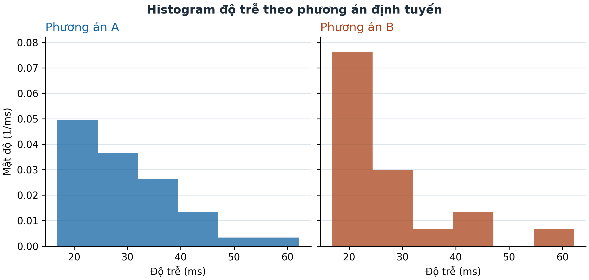
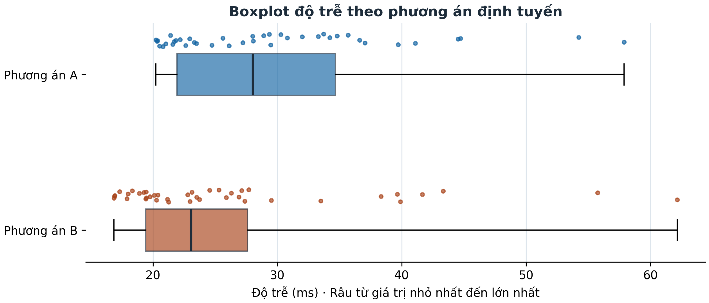

# So sánh hai phương án định tuyến bằng dữ liệu độ trễ

**Báo cáo Đề 8 · Nhóm 8 · Phương pháp thống kê dữ liệu**

## 1. Tình huống và mục tiêu

Một hệ thống mạng có thể truyền dữ liệu theo hai phương án định tuyến, A và B. Độ trễ của từng lần truyền được tính bằng mili giây (ms). Bài toán dùng hai mẫu mô phỏng độc lập để xem phương án nào có xu hướng cho độ trễ thấp hơn và mức bằng chứng thay đổi ra sao khi tiêu chí so sánh là thứ hạng hoặc trung bình.

Phân tích dùng 40 quan sát cho mỗi phương án. Trước hết, báo cáo mô tả mức điển hình, độ phân tán và phần đuôi của hai mẫu. Sau đó, kiểm định Mann–Whitney hai phía đánh giá khác biệt giữa các phân phối trong thiết kế cùng dạng dịch vị trí, còn Welch hai phía đánh giá chênh lệch trung bình. Mức ý nghĩa là 5% cho cả hai kiểm định. Cuối cùng, 200 cặp mẫu mới dùng để ước lượng tần suất Mann–Whitney phát hiện sự dịch chuyển trong mô hình đã cho.

## Tóm tắt

Theo mô hình của đề, B có phân phối độ trễ dịch xuống 4 ms so với A. Ở mẫu chính, trung bình mẫu của B thấp hơn A 3,493 ms và trung vị mẫu thấp hơn 4,981 ms. Mann–Whitney bác bỏ giả thuyết hai phân phối bằng nhau (UA = 1.070, p = 0,009507). Welch cho p = 0,118994, nên bằng chứng về chênh lệch trung bình ở riêng mẫu này chưa đạt mức 5%. Mann–Whitney bác bỏ trong 147/200 lần lặp (73,5%).

Phạm vi kết luận là cơ chế sinh dữ liệu của Đề 8. Việc suy rộng sang mạng đang vận hành đòi hỏi dữ liệu đo phù hợp với hệ thống cần đánh giá. Kết quả dùng seed 8 và tham chiếu đến bộ đề [Đ] cùng bài giảng [GT]. Số trang trích dẫn là số in trên tài liệu. [Thông tin tài liệu nguồn](../references/README.md)

<!-- pagebreak -->

## 2. Cơ sở lý thuyết và liên hệ các chương

### Phân phối mũ và mẫu độc lập

Với λ > 0, mật độ của biến mũ là f(z) = λ exp(−λz) khi z ≥ 0, bằng 0 khi z < 0. Kỳ vọng bằng 1/λ và phương sai bằng 1/λ². Cộng một hằng số làm thay đổi vị trí và kỳ vọng, còn phương sai giữ nguyên. Vì hai nhóm dùng cùng λ, phép dịch 4 ms bảo toàn dạng của phân phối. [GT] §1.3.2.1–2, §1.5.2.2, trang 17–18, 32–34.

Trong mỗi mẫu, các quan sát được sinh độc lập từ cùng một mô hình của nhóm. Hai nhóm cũng độc lập với nhau theo thiết kế. Số thứ tự của lần sinh dùng để tìm lại quan sát. [GT] §1.4.3, §4.1–4.2, trang 24–25, 99–100.

### Mức ý nghĩa và xác suất ở đuôi

H₀ là giả thuyết đang được kiểm tra. Giá trị p lượng hóa mức cực đoan của thống kê quan sát dưới H₀ theo quy tắc của kiểm định. Với kiểm định hai phía, cả hai chiều khác biệt đều được xét. Mức ý nghĩa α đặt ngưỡng cho quyết định bác bỏ. [GT] §5.1.3.1–3, trang 129–134.

### Vai trò của Chương 1–5 đối với Chương 7

| Chương | Nội dung áp dụng trong bài |
|---|---|
| 1 | Phân phối mũ, độc lập và phép dịch xác định hai phân phối mà Mann–Whitney so sánh. |
| 2 | Phân biệt dữ liệu mô phỏng với quan sát thực tế và nhận diện khi nào thiết kế có thể ghép theo yếu tố khống chế (§2.4.2–3). |
| 3 | Thống kê mô tả và đồ thị bộc lộ phần đuôi phải và mức dịch của vùng trung tâm. |
| 4 | Mẫu ngẫu nhiên và biến thiên qua các lần lấy mẫu giải thích vì sao phải lặp mô phỏng. |
| 5 | Giả thuyết, mức ý nghĩa và xác suất bác bỏ định hướng việc đọc kết quả Chương 7. Welch cung cấp đối chiếu theo trung bình. |

Các bước xếp hạng và kiểm định chính theo Chương 7. Căn cứ về công thức và quy ước triển khai được phân loại theo trang in và trang PDF. [Bảng đối chiếu giáo trình](SOURCE_MAPPING.md)

<!-- pagebreak -->

## 3. Thiết kế mô phỏng và thống kê mô tả

Nhóm A lấy X = 20 + Z và nhóm B lấy Y = 16 + Z′, trong đó Z, Z′ có cùng phân phối mũ với kỳ vọng 10 ms. Do 1/λ = 10 ms, λ = 0,1 ms⁻¹. Các cận dưới là 20 ms cho A và 16 ms cho B. Kỳ vọng theo mô hình là 30 và 26 ms, phương sai của mỗi nhóm là 100 ms². Các đại lượng này đặc tả tổng thể mô phỏng. [Đ] trang 9 và [GT] §1.3.2.1–2, §1.5.2.2.

Từ seed gốc 8, NumPy tách hai seed con cho hai luồng PCG64. Mỗi luồng sinh 40 giá trị qua `Generator.exponential(scale=10, size=40)`, sau đó cộng hằng số dịch của nhóm. Chương trình lưu các quan sát theo thứ tự phát sinh. Mẫu chính và 200 lần lặp lấy các khối liên tiếp từ hai luồng. [Dữ liệu mẫu chính](../data/samples.csv)

### Đại lượng tính từ mẫu

Với xᵢ là quan sát thứ i trong một nhóm, x̄ = Σxᵢ/n và s = √[Σ(xᵢ − x̄)²/(n − 1)]. Trung vị là trung bình hai quan sát ở vị trí 20 và 21 sau khi sắp tăng. Q₁ và Q₃ nội suy tuyến tính ở vị trí 10,25 và 30,75 theo h = (n + 1)p. IQR = Q₃ − Q₁ đo độ rộng của nửa giữa. Vị trí nội suy là quy ước dự án dựa trên [GT] §3.3.1–2 và §5.3.2.1, trang 73–77, 152. Mẫu số n − 1 theo §5.3.2.2, trang 154.

| Nhóm | n | Trung bình (ms) | Trung vị (ms) | SD (ms) | Q₁ (ms) | Q₃ (ms) | IQR (ms) |
|---|---:|---:|---:|---:|---:|---:|---:|
| A | 40 | 29,809 | 28,034 | 9,273 | 21,926 | 34,653 | 12,726 |
| B | 40 | 26,316 | 23,053 | 10,505 | 19,422 | 27,614 | 8,192 |

B có mức điển hình thấp hơn theo cả trung bình và trung vị mẫu. Nửa giữa của B hẹp hơn, trong khi SD của B lớn hơn. IQR mô tả vùng giữa, còn SD sử dụng khoảng cách đến trung bình của tất cả các giá trị, nên phần đuôi có thể làm hai thước đo phản ánh những khía cạnh khác nhau. [Bảng thống kê đầy đủ](../results/descriptive.csv)

<!-- pagebreak -->

## 4. Histogram của hai mẫu

*Hình 1. Mật độ thực nghiệm của độ trễ theo hai phương án.*

Cả hai nhóm dùng chung sáu khoảng lớp độ rộng khoảng 7,551 ms, trải từ 16,858 đến 62,163 ms. Chiều cao là số quan sát trong lớp chia cho cỡ mẫu và độ rộng lớp. Tổng diện tích các cột của từng nhóm bằng 1. Cách đặt lớp chung giúp đối chiếu trực tiếp hai nhóm. [GT] §3.3.2, trang 74–76.

Trong lớp đầu đến 24,409 ms có 15 quan sát A và 23 quan sát B. Ở hai lớp cuối, mỗi nhóm chỉ có hai quan sát. Khối quan sát tập trung ở vùng thấp và thưa dần về phía độ trễ cao, phù hợp với đuôi phải của mô hình. Mẫu B tập trung hơn ở các lớp đầu nhưng vẫn có quan sát đến 62,163 ms. Các lớp mô tả mẫu đã sinh và giữ đủ 40 quan sát mỗi nhóm.

<!-- pagebreak -->

## 5. Boxplot và độ phân tán

*Hình 2. Trung vị, vùng tứ phân vị và các giá trị quan sát.*

Hộp biểu thị Q₁ đến Q₃. Đường trong hộp là trung vị. Hai râu vẽ đến min và max theo quy ước tóm tắt năm số. Các chấm biểu diễn toàn bộ độ trễ của mẫu. [GT] §5.3.2.1, trang 151 và Bài 3.6, trang 93.

Hộp B nằm thấp hơn và ngắn hơn hộp A. Hai khoảng quan sát vẫn chồng lên nhau. Râu trên kéo dài đến 57,871 ms ở A và 62,163 ms ở B, vượt đáng kể Q₃ của mỗi nhóm. Điều đó giúp giải thích vì sao B có SD lớn hơn dù IQR nhỏ hơn. Do boxplot dùng râu min–max, các điểm xa hộp được mô tả là quan sát ở đuôi. Mọi điểm đều được giữ trong phân tích.

<!-- pagebreak -->

## 6. Mann–Whitney hai phía và bảng hạng

Kiểm định xét H₀: Fₓ = Fᵧ, đối lại H₁: Fₓ ≠ Fᵧ. Bài giảng đặt bài toán cho hai mẫu độc lập từ các phân phối liên tục và xây dựng diễn giải vị trí với hai phân phối cùng dạng. Ở đây phân phối mũ dịch lệch phải, thỏa thiết kế độc lập và cùng dạng. [GT] §7.2–7.2.1, trang 210–213.

Gộp và sắp tăng 80 quan sát, giữ nhóm và chỉ số gốc rồi gán hạng từ 1. Nếu có quan sát bằng nhau, mỗi quan sát nhận hạng trung bình của các vị trí tương ứng theo quy tắc hạng gộp ở §7.3.1, trang 214. Mẫu chính không có hạng trùng.

| Hạng | Nhóm | Chỉ số gốc | Độ trễ (ms) |
|---:|---|---:|---:|
| 1 | B | 28 | 16,858 |
| 2 | B | 21 | 16,911 |
| 3 | B | 20 | 16,926 |

Tổng hạng RA = 1.890 và RB = 1.350, cộng bằng 80 × 81/2 = 3.240. Các đẳng thức in ở trang 212 đồng nhất U với tổng hạng và đồng thời cộng thêm hằng số, mâu thuẫn với tâm của U ở trang 213. Theo quy ước người dùng đã xác nhận, UA = RA − 820 = 1.070 và UB = RB − 820 = 530. Có đúng 1.070 cặp chéo với A > B và 530 cặp với B > A trong 1.600 cặp. [Bảng 80 hạng](../results/ranks.csv) · [Công thức gốc và kiểm chứng](ISSUES.md)

Với U* = max(UA,UB), tâm 800 và phương sai 10.800 theo (7.8), z = (1.070 − 800 − 0,5)/√10.800 = 2,593265. Hiệu chỉnh 0,5 dùng trước khi lấy xác suất hai đuôi, p = min(1, 2P(Z ≥ z)) = 0,009507. Hàm `scipy.stats.mannwhitneyu(a, b, ...)` khớp cả UA và p khi dùng `method="asymptotic"`, `alternative="two-sided"` và `use_continuity=True`. Vì p ≤ 0,05, bác bỏ H₀. Thứ hạng quan sát nghiêng về độ trễ lớn hơn ở A, phù hợp với chiều dịch đã biết của mô hình.

<!-- pagebreak -->

## 7. Welch hai phía và đối chiếu hai kiểm định

Welch xét H₀: μA − μB = 0, đối lại H₁: μA − μB ≠ 0. Phương pháp dùng phương sai ước lượng riêng của từng mẫu. Với wA = sA²/nA và wB = sB²/nB, sai số chuẩn là SE = √(wA + wB), t = (x̄ − ȳ)/SE. Bậc tự do xấp xỉ là ν = (wA + wB)²/[wA²/(nA − 1) + wB²/(nB − 1)]. [GT] §5.3.2.2, (5.38), (5.40), Bảng 5.7, trang 159–160.

| Đại lượng Welch | Giá trị |
|---|---:|
| Chênh lệch trung bình A − B | 3,493339 ms |
| Sai số chuẩn | 2,215453 ms |
| t quan sát | 1,576805 |
| ν tính được | 76,817153 |
| Bậc tự do dùng theo bài giảng | 76 |
| p hai phía với ν làm tròn xuống | 0,118994 |
| p đối chiếu SciPy với ν thập phân | 0,118950 |

Theo quy ước làm tròn xuống ở trang 159, p = 2P(T₇₆ ≥ |t|). Giá trị p lớn hơn 0,05, nên chưa đủ bằng chứng bác bỏ giả thuyết bằng nhau về trung bình. Ước lượng chênh lệch mẫu vẫn dương. Welch yêu cầu hai mẫu độc lập và công thức t của bài giảng được dẫn xuất trong bối cảnh tổng thể chuẩn. Với hai mẫu mũ dịch cỡ 40 và phương sai tổng thể hữu hạn, bài dùng Welch theo yêu cầu của đề và xem kết quả là xấp xỉ, dựa vào lập luận về phân phối của trung bình mẫu. [GT] §4.4.1, §5.3.2.2, trang 102–103, 153–160.

Mann–Whitney dùng thứ tự và trong mô hình này có thể diễn giải theo dịch vị trí. Welch sử dụng độ lớn của các giá trị để so sánh trung bình, với sai số chuẩn phụ thuộc phương sai mẫu. Hai kiểm định cho quyết định khác nhau tại mức 5% vì chúng dùng thông tin và giả thuyết khác nhau. Một kết quả có ý nghĩa thống kê cho thứ hạng có thể đi cùng bằng chứng chưa đủ mạnh về chênh lệch trung bình.

<!-- pagebreak -->

## 8. Hai trăm lần lặp và điều kiện ghép cặp

Mỗi lần lặp sinh thêm 40 quan sát A và 40 quan sát B, áp dụng đúng quy tắc Mann–Whitney hai phía của mẫu chính rồi lưu p-value và quyết định. Hai luồng tiếp tục từ trạng thái sau lần sinh trước. Trong 200 lần lặp có 147 lần bác bỏ và 53 lần chưa bác bỏ H₀, cho tỷ lệ phát hiện 147/200 = 73,5%. Giá trị U và p-value được đối chiếu với SciPy ở mọi lần. Sai lệch tuyệt đối lớn nhất giữa hai p-value là 1,94 × 10⁻¹⁶. [Kết quả từng lần](../results/simulation_runs.csv) · [Dữ liệu sinh từng lần](../data/simulation_samples.csv)

Tỷ lệ này là tần suất quan sát của kiểm định dưới mô hình dịch 4 ms, cỡ mẫu 40 mỗi nhóm và mức 5%. Nó ước lượng xác suất phát hiện trong thiết kế đã cố định. Một quyết định tương ứng với 0,5 điểm phần trăm và lần chạy bằng seed khác có thể cho tần suất khác. [GT] §5.2.1.2, trang 139–144.

Không có hạng trùng trong mẫu chính và 200 lần lặp. Chương trình kiểm thử riêng với mẫu có giá trị trùng, bao gồm trường hợp tất cả giá trị bằng nhau. Hiệu chỉnh phương sai khi có ties là phần mở rộng kỹ thuật được xác nhận và đối chiếu SciPy. [Chi tiết phương pháp](METHODOLOGY.md) · [Kiểm chứng và giới hạn nguồn](ISSUES.md)

### Vì sao dùng hai mẫu độc lập

Trong thiết kế ghép cặp, hai phép đo phải thuộc cùng đơn vị hoặc được liên kết bởi tiêu chí ghép định trước. Ví dụ, mỗi kịch bản mạng có thể được thử lần lượt bằng cả hai cách định tuyến, khi đó cặp được định nghĩa bởi kịch bản. Phân tích dùng sai khác trong từng cặp và các cặp phải độc lập với nhau. [GT] §5.3.1, trang 149–151 và §5.3.2.2, trang 161–162.

Ở Đề 8, A₁ và B₁ chỉ là lần rút đầu của hai luồng. Ghép theo cùng số thứ tự tạo một liên kết tùy ý, không phản ánh cùng kịch bản hoặc đơn vị thực nghiệm. Vì vậy cấu trúc dữ liệu phù hợp với kiểm định hai mẫu độc lập.

<!-- pagebreak -->

## 9. Thảo luận và kết luận

B có độ trễ thấp hơn trong mô hình vì hai phân phối cùng dạng và vị trí của B thấp hơn 4 ms. Chênh lệch này đến từ hai hằng số dịch đã cho. Trong mẫu, chênh lệch trung bình quan sát là 3,493 ms và chênh lệch trung vị là 4,981 ms, đều theo chiều B thấp hơn. Vùng giữa của B hẹp hơn nhưng phần đuôi phía trên vẫn chứa các độ trễ lớn. Trong thực hành, một lựa chọn định tuyến có thể cần cân nhắc đồng thời mức điển hình và độ trễ ở đuôi.

Ở mức 5%, Mann–Whitney (UA = 1.070, p = 0,009507) cho bằng chứng về khác biệt phân phối và chiều thứ hạng phù hợp với vị trí thấp hơn của B. Diễn giải dịch vị trí dựa vào hai phân phối cùng dạng theo mô hình. Welch (t = 1,576805, p = 0,118994) cho bằng chứng chưa đủ để kết luận chênh lệch trung bình ở mẫu chính. Thứ hạng và trung bình là hai đích suy luận khác nhau. Tỷ lệ 73,5% qua 200 lần lặp mô tả hiệu năng của Mann–Whitney trong cấu hình mô phỏng đã chọn.

Thiết kế dùng cùng tham số tỷ lệ mũ, cỡ mẫu cố định và hai luồng độc lập. Độ trễ đo trên mạng có thể có hình dạng, mức biến thiên hoặc quan hệ phụ thuộc khác. Khi áp dụng cho một hệ thống thực tế, chất lượng kết luận phụ thuộc vào thiết kế đo và mức phù hợp của các điều kiện kiểm định. Một tỷ lệ từ 200 lần lặp cũng có biến thiên do lấy mẫu hữu hạn.

## Tài liệu tham khảo

1. **[Đ] Bộ đề bài tập nhóm Phương pháp thống kê dữ liệu.** Yêu cầu và quy ước, trang 1. Đề 8, trang 9. Sản phẩm nộp, trang 12.
2. **[GT] Bài giảng Phương pháp thống kê dữ liệu.** Chương 1, §1.3.2, §1.4.3, §1.5.2.2. Chương 2, §2.4.2–3. Chương 3, §3.3. Chương 4, §4.1–4.4. Chương 5, §5.1–5.3. Chương 7, §7.2–7.3. [Chỉ mục trang và thông tin bản gốc](SOURCE_MAPPING.md)

<!-- pagebreak -->

## Phụ lục A. Dữ liệu, kết quả và mã nguồn

| Tài liệu | Nội dung |
|---|---|
| [Mẫu chính](../data/samples.csv) và [mẫu lặp](../data/simulation_samples.csv) | Giá trị mô phỏng theo nhóm và thứ tự sinh |
| [Thống kê mô tả](../results/descriptive.csv) và [bảng hạng](../results/ranks.csv) | Các thống kê chưa làm tròn và đủ 80 hạng |
| [Cấu hình và kết quả](../results/run.json) | Seed, tham số, phiên bản và hai kiểm định |
| [Bảng 200 lần](../results/simulation_runs.csv) | U, số cặp, p-value, đối chiếu và quyết định từng lần |
| [Mã nguồn](../src/) và [kiểm thử](../tests/) | Sinh mẫu, tính toán, đồ thị và kiểm tra tái lập |
| [Hướng dẫn chạy](../README.md) | Cài đặt, chạy lại và kiểm thử |

Chương trình dùng Python 3.12.14, NumPy 2.3.5, SciPy 1.16.3 và Matplotlib 3.10.8. Chạy `python -m src.main` từ thư mục dự án sau khi cài các gói trong `requirements.txt`. Seed mặc định là 8.

## Phụ lục B. Bảng phân công của nhóm

Nhóm có năm thành viên theo danh sách được cung cấp. Mỗi mã trong bảng ứng với một thành viên trong danh sách đối chiếu nội bộ. Cột đóng góp chờ nhóm xác nhận phần việc thực tế.

| Thành viên | Đóng góp thực tế |
|---|---|
| 01 | Chờ xác nhận |
| 02 | Chờ xác nhận |
| 03 | Chờ xác nhận |
| 04 | Chờ xác nhận |
| 05 | Chờ xác nhận |
