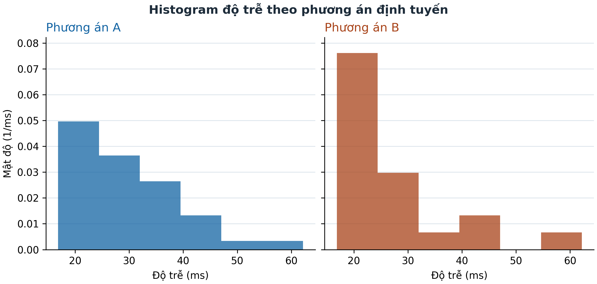
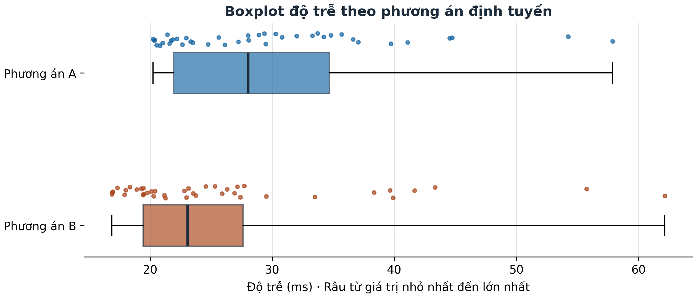

# So sánh hai phương án định tuyến bằng dữ liệu độ trễ

**Báo cáo Đề 8 · Nhóm 8 · Phương pháp thống kê dữ liệu**

## 1. Tình huống và mục tiêu

Độ trễ là thời gian cần để dữ liệu đi qua mạng, tính bằng mili giây (ms). Đề 8 đặt ra hai phương án định tuyến A và B rồi mô phỏng 40 phiên truyền độc lập cho mỗi phương án. Câu hỏi của bài là phương án nào thường có độ trễ thấp hơn và một mẫu cỡ 40 mỗi nhóm cho thấy khác biệt rõ đến đâu.

Nhóm dùng bảng thống kê và biểu đồ để xem các giá trị tập trung ở đâu, phân tán thế nào. Sau đó, nhóm so sánh thứ hạng bằng Mann–Whitney và so sánh trung bình bằng Welch. Cả hai kiểm định đều xét hai phía ở mức ý nghĩa 5%. Để xem kết quả Mann–Whitney thay đổi thế nào khi lấy mẫu mới, nhóm lặp lại phép thử 200 lần.

## Tóm tắt

Theo mô hình của đề, phân phối độ trễ của B dịch xuống 4 ms so với A. Trong mẫu chính, độ trễ trung bình của B thấp hơn A khoảng 3,49 ms. Mann–Whitney cho p = 0,009507 và bác bỏ giả thuyết hai phân phối bằng nhau. Welch cho p = 0,118994, nên mẫu này chưa cho đủ bằng chứng về chênh lệch trung bình ở mức 5%. Mann–Whitney phát hiện khác biệt trong 147/200 lần lặp (73,5%).

Tất cả số liệu trong báo cáo là kết quả mô phỏng với seed 8. Các ký hiệu [Đ] và [GT] lần lượt chỉ bộ đề và bài giảng. Số trang trích dẫn là số in trên tài liệu. [Thông tin tài liệu nguồn](../references/README.md)

<!-- pagebreak -->

## 2. Cơ sở lý thuyết và liên hệ các chương

### Phân phối mũ và mẫu độc lập

Với λ > 0, mật độ của biến mũ là f(z) = λ exp(−λz) khi z ≥ 0, bằng 0 khi z < 0. Kỳ vọng bằng 1/λ và phương sai bằng 1/λ². Cộng một hằng số làm thay đổi vị trí và kỳ vọng, còn phương sai giữ nguyên. Vì hai nhóm dùng cùng λ, phép dịch 4 ms bảo toàn dạng của phân phối. [GT] §1.3.2.1–2, §1.5.2.2, trang 17–18, 32–34.

Trong mỗi mẫu, các quan sát được sinh độc lập từ cùng một mô hình của nhóm. Hai nhóm cũng độc lập với nhau theo thiết kế. Số thứ tự của lần sinh dùng để tìm lại quan sát. [GT] §1.4.3, §4.1–4.2, trang 24–25, 99–100.

### Mức ý nghĩa và xác suất ở đuôi

Nếu giả thuyết gốc H₀ đúng, p-value là xác suất thu được thống kê kiểm định ít nhất cũng cực đoan như giá trị quan sát, theo quy tắc của phép kiểm định. Kiểm định hai phía tính đến khác biệt theo cả hai chiều. Bài dùng ngưỡng ý nghĩa α = 0,05. [GT] §5.1.3.1–3, trang 129–134.

### Vai trò của Chương 1–5 đối với Chương 7

| Chương | Nội dung áp dụng trong bài |
|---|---|
| 1 | Phân phối mũ, độc lập và phép dịch xác định hai phân phối mà Mann–Whitney so sánh. |
| 2 | Phân biệt dữ liệu mô phỏng với quan sát thực tế và nhận diện khi nào thiết kế có thể ghép theo yếu tố khống chế (§2.4.2–3). |
| 3 | Thống kê mô tả và đồ thị bộc lộ phần đuôi phải và mức dịch của vùng trung tâm. |
| 4 | Mẫu ngẫu nhiên và biến thiên qua các lần lấy mẫu giải thích vì sao phải lặp mô phỏng. |
| 5 | Giả thuyết, mức ý nghĩa và xác suất bác bỏ định hướng việc đọc kết quả Chương 7. Welch cung cấp đối chiếu theo trung bình. |

Các bước xếp hạng và kiểm định chính theo Chương 7. Căn cứ về công thức và quy ước triển khai được phân loại theo trang in và trang PDF. [Bảng đối chiếu giáo trình](SOURCE_MAPPING.md)

<!-- pagebreak -->

## 3. Thiết kế mô phỏng và thống kê mô tả

Nhóm A lấy X = 20 + Z và nhóm B lấy Y = 16 + Z′, trong đó Z, Z′ có cùng phân phối mũ với kỳ vọng 10 ms. Do 1/λ = 10 ms, λ = 0,1 ms⁻¹. Các cận dưới là 20 ms cho A và 16 ms cho B. Kỳ vọng theo mô hình là 30 và 26 ms, phương sai của mỗi nhóm là 100 ms². Các đại lượng này đặc tả tổng thể mô phỏng. [Đ] trang 9 và [GT] §1.3.2.1–2, §1.5.2.2.

NumPy tách seed gốc 8 thành hai seed con để khởi tạo hai bộ sinh PCG64, mỗi phương án dùng một bộ sinh. Mỗi lượt, chương trình gọi `Generator.exponential(scale=10, size=40)` cho từng nhóm rồi cộng 20 ms hoặc 16 ms. Hai bộ sinh tiếp tục từ trạng thái hiện tại ở mỗi lần lặp. Chương trình lưu thứ tự phát sinh để có thể đối chiếu từng giá trị. [Dữ liệu mẫu chính](../data/samples.csv)

### Đại lượng tính từ mẫu

Với xᵢ là quan sát thứ i trong một nhóm, x̄ = Σxᵢ/n và s = √[Σ(xᵢ − x̄)²/(n − 1)]. Trung vị là trung bình hai quan sát ở vị trí 20 và 21 sau khi sắp tăng. Q₁ và Q₃ nội suy tuyến tính ở vị trí 10,25 và 30,75 theo h = (n + 1)p. IQR = Q₃ − Q₁ đo độ rộng của nửa giữa. Vị trí nội suy là quy ước dự án dựa trên [GT] §3.3.1–2 và §5.3.2.1, trang 73–77, 152. Mẫu số n − 1 theo §5.3.2.2, trang 154.

| Nhóm | n | Trung bình (ms) | Trung vị (ms) | SD (ms) | Q₁ (ms) | Q₃ (ms) | IQR (ms) |
|---|---:|---:|---:|---:|---:|---:|---:|
| A | 40 | 29,809 | 28,034 | 9,273 | 21,926 | 34,653 | 12,726 |
| B | 40 | 26,316 | 23,053 | 10,505 | 19,422 | 27,614 | 8,192 |

Trung bình và trung vị mẫu đều thấp hơn ở B. IQR của B cũng nhỏ hơn, tức nửa giữa của mẫu tập trung hơn. Độ lệch chuẩn của B lại cao hơn vì thước đo này tính cả các quan sát nằm xa trung bình. Biểu đồ hộp ở §5 cho thấy các điểm độ trễ cao của B. [Bảng thống kê đầy đủ](../results/descriptive.csv)

<!-- pagebreak -->

## 4. Histogram của hai mẫu

*Hình 1. Mật độ thực nghiệm của độ trễ theo hai phương án.*

Cả hai nhóm dùng chung sáu khoảng lớp, mỗi khoảng rộng khoảng 7,551 ms, từ 16,858 đến 62,163 ms. Nhờ dùng cùng các mốc, có thể so hai nhóm ngay trong từng khoảng độ trễ. Chiều cao mỗi cột bằng số quan sát trong khoảng chia cho 40 và độ rộng khoảng. Tổng diện tích các cột của mỗi nhóm bằng 1. [GT] §3.3.2, trang 74–76.

Khoảng đầu tiên, đến 24,409 ms, có 15 quan sát của A và 23 quan sát của B. Ở hai khoảng cuối, mỗi nhóm chỉ có hai quan sát. Các giá trị tập trung ở vùng độ trễ thấp và thưa hơn về phía phải. B có nhiều quan sát ở vùng thấp, đồng thời có một giá trị lên đến 62,163 ms.

<!-- pagebreak -->

## 5. Boxplot và độ phân tán

*Hình 2. Trung vị, vùng tứ phân vị và các giá trị quan sát.*

Hộp biểu thị Q₁ đến Q₃. Đường trong hộp là trung vị. Hai râu vẽ đến min và max theo quy ước tóm tắt năm số. Các chấm biểu diễn toàn bộ độ trễ của mẫu. [GT] §5.3.2.1, trang 151 và Bài 3.6, trang 93.

Hộp của B hẹp hơn và nằm về phía độ trễ thấp hơn so với hộp của A. Hai mẫu vẫn có nhiều giá trị ở cùng vùng. Ở phía độ trễ cao, râu kéo đến 57,871 ms ở A và 62,163 ms ở B. Các điểm xa hộp của B giúp giải thích vì sao độ lệch chuẩn của B lớn hơn dù IQR nhỏ hơn. Hình dùng râu từ giá trị nhỏ nhất đến lớn nhất và mọi quan sát đều được giữ khi tính toán.

<!-- pagebreak -->

## 6. Mann–Whitney hai phía và bảng hạng

Giả thuyết H₀ là A và B có cùng phân phối độ trễ (Fₓ = Fᵧ). Giả thuyết H₁ là hai phân phối khác nhau (Fₓ ≠ Fᵧ). Hai mẫu được sinh độc lập từ các phân phối liên tục và lệch phải. Vì đề cho hai phân phối cùng dạng, nhóm có thể dùng kết quả thứ hạng để bàn về sự dịch chuyển vị trí. [GT] §7.2–7.2.1, trang 210–213.

Gộp và sắp tăng 80 quan sát, giữ nhóm và chỉ số gốc rồi gán hạng từ 1. Nếu có quan sát bằng nhau, mỗi quan sát nhận hạng trung bình của các vị trí tương ứng theo quy tắc hạng gộp ở §7.3.1, trang 214. Mẫu chính không có hạng trùng.

| Hạng | Nhóm | Chỉ số gốc | Độ trễ (ms) |
|---:|---|---:|---:|
| 1 | B | 28 | 16,858 |
| 2 | B | 21 | 16,911 |
| 3 | B | 20 | 16,926 |

Tổng hạng của A là RA = 1.890 và của B là RB = 1.350. Hai số cộng lại bằng 80 × 81/2 = 3.240. Cách viết U ở trang 212 không khớp với kỳ vọng của U ở trang 213. Bài dùng UA = RA − 820 = 1.070 và UB = RB − 820 = 530. Số 820 là tổng hạng từ 1 đến 40. Kiểm tra trực tiếp 1.600 cặp chéo cho đúng 1.070 cặp A > B và 530 cặp B > A. [Bảng 80 hạng](../results/ranks.csv) · [Công thức gốc và kiểm chứng](ISSUES.md)

Với U* = max(UA,UB), tâm 800 và phương sai 10.800 theo (7.8), z = (1.070 − 800 − 0,5)/√10.800 = 2,593265. Hiệu chỉnh 0,5 dùng trước khi lấy xác suất hai đuôi, p = min(1, 2P(Z ≥ z)) = 0,009507. Hàm `scipy.stats.mannwhitneyu(a, b, ...)` khớp cả UA và p khi dùng `method="asymptotic"`, `alternative="two-sided"` và `use_continuity=True`. Vì p ≤ 0,05, bác bỏ H₀. Thứ hạng quan sát nghiêng về độ trễ lớn hơn ở A, phù hợp với chiều dịch đã biết của mô hình.

<!-- pagebreak -->

## 7. Welch hai phía và đối chiếu hai kiểm định

Welch xét H₀: μA − μB = 0, đối lại H₁: μA − μB ≠ 0. Phương pháp dùng phương sai ước lượng riêng của từng mẫu. Với wA = sA²/nA và wB = sB²/nB, sai số chuẩn là SE = √(wA + wB), t = (x̄ − ȳ)/SE. Bậc tự do xấp xỉ là ν = (wA + wB)²/[wA²/(nA − 1) + wB²/(nB − 1)]. [GT] §5.3.2.2, (5.38), (5.40), Bảng 5.7, trang 159–160.

| Đại lượng Welch | Giá trị |
|---|---:|
| Chênh lệch trung bình A − B | 3,493339 ms |
| Sai số chuẩn | 2,215453 ms |
| t quan sát | 1,576805 |
| ν tính được | 76,817153 |
| Bậc tự do dùng theo bài giảng | 76 |
| p hai phía với ν làm tròn xuống | 0,118994 |
| p đối chiếu SciPy với ν thập phân | 0,118950 |

Theo quy ước làm tròn xuống ở trang 159, p = 2P(T₇₆ ≥ |t|). Giá trị p lớn hơn 0,05, nên chưa đủ bằng chứng bác bỏ giả thuyết bằng nhau về trung bình. Ước lượng chênh lệch mẫu vẫn dương. Welch yêu cầu hai mẫu độc lập và công thức t của bài giảng được dẫn xuất trong bối cảnh tổng thể chuẩn. Với hai mẫu mũ dịch cỡ 40 và phương sai tổng thể hữu hạn, bài dùng Welch theo yêu cầu của đề và xem kết quả là xấp xỉ, dựa vào lập luận về phân phối của trung bình mẫu. [GT] §4.4.1, §5.3.2.2, trang 102–103, 153–160.

Trong mô hình cùng dạng và chỉ dịch vị trí của đề, hai phân phối trùng nhau khi độ dịch bằng 0. Đây cũng là lúc hai trung bình tổng thể bằng nhau. Hai kiểm định vẫn có thể cho quyết định khác nhau trên cùng mẫu. Mann–Whitney chỉ dùng thứ tự các giá trị, còn Welch dùng chênh lệch trung bình và phương sai mẫu, nên độ lớn của các quan sát ở đuôi ảnh hưởng trực tiếp đến kết quả Welch.

<!-- pagebreak -->

## 8. Hai trăm lần lặp và điều kiện ghép cặp

Mỗi lần lặp sinh thêm 40 quan sát A và 40 quan sát B, áp dụng đúng quy tắc Mann–Whitney hai phía của mẫu chính rồi lưu p-value và quyết định. Hai luồng tiếp tục từ trạng thái sau lần sinh trước. Trong 200 lần lặp có 147 lần bác bỏ và 53 lần chưa bác bỏ H₀, cho tỷ lệ phát hiện 147/200 = 73,5%. Giá trị U và p-value được đối chiếu với SciPy ở mọi lần. Sai lệch tuyệt đối lớn nhất giữa hai p-value là 1,94 × 10⁻¹⁶. [Kết quả từng lần](../results/simulation_runs.csv) · [Dữ liệu sinh từng lần](../data/simulation_samples.csv)

Tỷ lệ 73,5% ước lượng xác suất phát hiện khác biệt của Mann–Whitney khi mô hình dịch 4 ms, mỗi nhóm có 40 quan sát và mức ý nghĩa là 5%. Với 200 lần lặp, thêm hoặc bớt một lần bác bỏ sẽ làm tỷ lệ thay đổi 0,5 điểm phần trăm. Dùng seed khác có thể cho tỷ lệ khác. [GT] §5.2.1.2, trang 139–144.

Không có hạng trùng trong mẫu chính và 200 lần lặp. Chương trình kiểm thử riêng với mẫu có giá trị trùng, bao gồm trường hợp tất cả giá trị bằng nhau. Hiệu chỉnh phương sai khi có ties là phần mở rộng kỹ thuật được xác nhận và đối chiếu SciPy. [Chi tiết phương pháp](METHODOLOGY.md) · [Kiểm chứng và giới hạn nguồn](ISSUES.md)

### Vì sao dùng hai mẫu độc lập

Trong thiết kế ghép cặp, hai phép đo phải thuộc cùng đơn vị hoặc được liên kết bởi tiêu chí ghép định trước. Ví dụ, mỗi kịch bản mạng có thể được thử lần lượt bằng cả hai cách định tuyến, khi đó cặp được định nghĩa bởi kịch bản. Phân tích dùng sai khác trong từng cặp và các cặp phải độc lập với nhau. [GT] §5.3.1, trang 149–151 và §5.3.2.2, trang 161–162.

Ở Đề 8, A₁ và B₁ chỉ là lần rút đầu của hai luồng. Ghép theo cùng số thứ tự tạo một liên kết tùy ý, không phản ánh cùng kịch bản hoặc đơn vị thực nghiệm. Vì vậy cấu trúc dữ liệu phù hợp với kiểm định hai mẫu độc lập.

<!-- pagebreak -->

## 9. Thảo luận và kết luận

Theo mô hình của đề, B có độ trễ thấp hơn vì hai phân phối cùng dạng và B dịch xuống 4 ms. Con số 4 ms đến từ hai hằng số trong đề. Với mẫu đã sinh, trung bình của B thấp hơn 3,493 ms và trung vị thấp hơn khoảng 4,981 ms. Vùng giữa của B hẹp hơn, đồng thời mẫu B vẫn có vài phiên có độ trễ lớn.

Ở mức 5%, Mann–Whitney cho thấy thứ hạng của A có xu hướng cao hơn B. Giả thiết cùng dạng giúp diễn giải kết quả này theo vị trí. Welch cho p = 0,118994, nên riêng mẫu chính chưa cho đủ bằng chứng về chênh lệch trung bình. Kết quả 147/200 lần phát hiện cho thấy ngay cả khi mô hình có độ dịch 4 ms, những mẫu khác nhau vẫn có thể dẫn đến quyết định khác nhau.

Kết luận trên áp dụng cho dữ liệu mô phỏng đã chọn. Độ trễ trên mạng đang vận hành có thể phụ thuộc vào tải mạng và thời điểm đo. Muốn so sánh hai phương án trên hệ thống đó, cần có dữ liệu đo thực tế và xem các điều kiện của phép kiểm định có còn phù hợp hay không.

<!-- pagebreak -->

## Phụ lục A. Dữ liệu, kết quả và mã nguồn

| Tài liệu | Nội dung |
|---|---|
| [Mẫu chính](../data/samples.csv) và [mẫu lặp](../data/simulation_samples.csv) | Giá trị mô phỏng theo nhóm và thứ tự sinh |
| [Thống kê mô tả](../results/descriptive.csv) và [bảng hạng](../results/ranks.csv) | Các thống kê chưa làm tròn và đủ 80 hạng |
| [Cấu hình và kết quả](../results/run.json) | Seed, tham số, phiên bản và hai kiểm định |
| [Bảng 200 lần](../results/simulation_runs.csv) | U, số cặp, p-value, đối chiếu và quyết định từng lần |
| [Mã nguồn](../src/) và [kiểm thử](../tests/) | Sinh mẫu, tính toán, đồ thị và kiểm tra tái lập |
| [Hướng dẫn chạy](../README.md) | Cài đặt, chạy lại và kiểm thử |

Chương trình dùng Python 3.12.14, NumPy 2.3.5, SciPy 1.16.3 và Matplotlib 3.10.8. Chạy `python -m src.main` từ thư mục dự án sau khi cài các gói trong `requirements.txt`. Seed mặc định là 8.

## Phụ lục B. Bảng phân công của nhóm

Năm đầu việc được bốc ngẫu nhiên. Bảng ghi sản phẩm đã có để từng thành viên đối chiếu với phần việc mình thực hiện. Nhóm xác nhận đóng góp cá nhân trước khi nộp.

| Thành viên | Nhiệm vụ được giao | Sản phẩm đã có để đối chiếu | Đóng góp cá nhân |
|---|---|---|---|
| 01 | Dữ liệu mô phỏng, seed và kiểm tra tái lập | Hai tệp dữ liệu gốc, cấu hình seed và nhật ký chạy lại | Chờ xác nhận |
| 02 | Mann–Whitney, bảng hạng và 200 lần mô phỏng | Bảng 80 hạng, kết quả kiểm định và bảng 200 lần lặp | Chờ xác nhận |
| 03 | Thống kê mô tả, histogram và boxplot | Bảng thống kê, hai biểu đồ và phần nhận xét | Chờ xác nhận |
| 04 | Điều phối, đối chiếu đề và tổng hợp báo cáo | Bản báo cáo 10 trang và bảng kiểm yêu cầu | Chờ xác nhận |
| 05 | Welch, so sánh hai kiểm định và tổng hợp trình bày | Kết quả Welch và phần so sánh trong báo cáo | Chờ xác nhận |

## Tài liệu tham khảo

1. **[Đ] Bộ đề bài tập nhóm Phương pháp thống kê dữ liệu.** Yêu cầu chung (tr. 1), Đề 8 (tr. 9), sản phẩm nộp (tr. 12).
2. **[GT] Bài giảng Phương pháp thống kê dữ liệu.** Ch. 1 (§1.3.2, §1.4.3, §1.5.2.2), Ch. 2 (§2.4.2–3), Ch. 3 (§3.3), Ch. 4 (§4.1–4.4), Ch. 5 (§5.1–5.3) và Ch. 7 (§7.2–7.3). [Bảng đối chiếu trang in và trang PDF](SOURCE_MAPPING.md)
